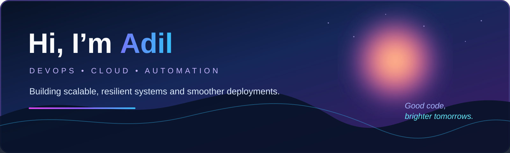

  

  
  
  

## 👋 About Me

I’m **Adil P M**, a DevOps Engineer focused on cloud-native technologies, CI/CD pipelines, and infrastructure automation. I enjoy building scalable, resilient systems, improving deployment workflows, and collaborating to solve operational problems.

- 📍 Bengaluru, Karnataka, India
- 🌱 Interested in cloud infrastructure, automation, monitoring, and cloud security
- 🤝 Open to opportunities to contribute to reliable cloud platforms and DevOps practices
- 📫 Reach me at [adilpm1975@gmail.com](mailto:adilpm1975@gmail.com)

## 📊 GitHub Stats

  
  

  

## ⚡ Tech Stack

  

| Area | Tools & technologies |
| --- | --- |
| Cloud | AWS: EC2, S3, IAM, VPC, CloudWatch, EBS, Auto Scaling, ELB · Azure: Virtual Machines, Entra ID, Storage, Backup, Load Balancer, Bastion, NSG |
| Infrastructure as Code | Terraform — init, plan, apply, and destroy |
| Containers | Docker, Dockerfiles, Docker Hub, Kubernetes, Minikube, Kind |
| CI/CD & source control | Jenkins, Git, GitHub, pull requests, branching, merging, rebasing, stashing, conflict resolution |
| Networking & security | IPv4, subnetting, internet gateways, NAT, VPC networking, Azure VNets, NSGs, backup and recovery |

## 🚀 Featured Project

### Behaviour-Aware Cloud Security Monitoring
*Anna University*

- Designed a cloud-security monitoring solution that analyzes Apache access logs to identify suspicious user activity.
- Applied log analysis and behavioural monitoring to detect unusual access patterns and potential threats.
- Built practical knowledge in cloud security, access monitoring, threat detection, and security analytics.

## 💼 Experience

**AWS Cloud Intern** · EMGLITZ Technologies  
*Nov 2025 – Jan 2026*

- Gained hands-on experience with AWS cloud services and cloud infrastructure.
- Assisted with provisioning and configuring EC2, S3, IAM, and VPC resources.
- Supported cloud deployment, networking, and infrastructure-management tasks.

**Cybersecurity Intern** · TechByHeart  
*2022*

- Studied network security, threat analysis, and vulnerability concepts.
- Monitored network traffic and investigated potential security threats using industry-standard tools and frameworks.
- Gained exposure to ethical-hacking fundamentals, firewall configuration, and security-policy documentation.

## 🎓 Education

- **B.E., Computer Science and Engineering (Cybersecurity)** — Dhanalakshmi Srinivasan College of Engineering, Anna University *(2022–2026)*
- **Higher Secondary Education, Computer Science** — Board of Higher Secondary Examinations, Government of Kerala *(2022)*

## 🌐 Languages

English · Malayalam · Tamil · Hindi

  <i>“Learn ✦ Build ✦ Share ✦ Grow”</i> 
  — Adil

